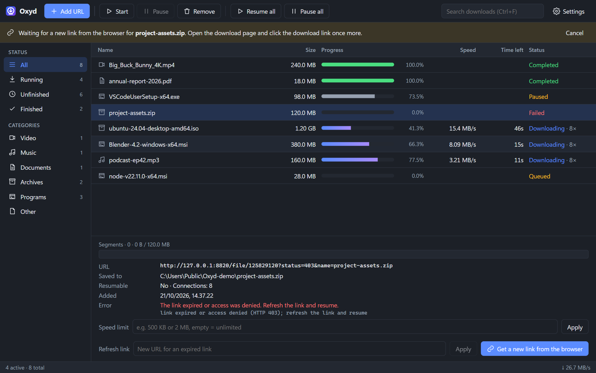
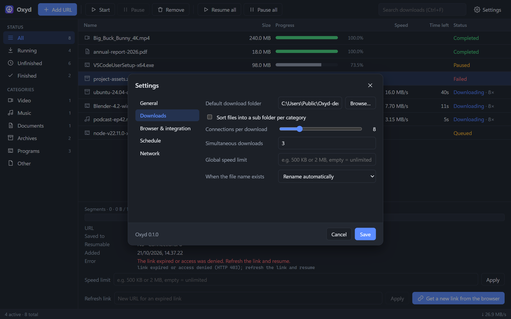

# Oxyd Download Manager

[](https://github.com/YosuaPWH/Oxyd-Download-Manager/actions/workflows/ci.yml)
[](https://github.com/YosuaPWH/Oxyd-Download-Manager/actions/workflows/build.yml)

A fast, lightweight download manager for Windows in the spirit of Internet Download Manager.
Oxyd splits every file into segments that download in parallel, survives crashes and lost
connections, picks up downloads from Chrome and Edge, and lets you continue a download from
where it stopped even after its link has expired.

<p align="center">
  
</p>

> The screenshots show sample downloads served by the local test server in this repository.

**Highlights**

- Up to **32 parallel connections** per file, with segments that rebalance themselves
- **Resume after anything**: pause, crash, power loss, lost network, app restart
- **Refresh an expired link** from the browser and continue from the last byte, like IDM
- **Chrome and Edge integration**: downloads are captured, cookies and referer included
- **Small**: the installer is about 5 MB and the app uses about 21 MB in the tray
- **Light and dark** themes that follow Windows, in English and Indonesian

## Contents

- [Design](#design) · [Everyday use](#everyday-use) · [Browser extension](#browser-extension)
- [How it works](#how-it-works) · [Install](#install) · [Build from source](#build-from-source)
- [Repository layout](#repository-layout) · [Documentation](#documentation) · [License](#license)

## Design

Oxyd is a single window that keeps the download list in the middle and everything else out of
the way. It is built with Svelte 5 inside a Tauri 2 shell (WebView2), so it starts fast and
looks the same on every Windows 10/11 machine.

| Dark | Light |
|---|---|
|  |  |

**Layout**

- **Toolbar**: *Add URL*, *Start*, *Pause*, *Remove*, *Resume all*, *Pause all*, search and
  settings. On narrow windows the secondary buttons shrink to icons with tooltips.
- **Sidebar**: status filters (*All*, *Running*, *Unfinished*, *Finished*) and automatic
  categories (Video, Music, Documents, Archives, Programs, Other) with live counts.
- **Download list**: name, size, progress, speed, time left and status. Each row has an icon
  for its category and a colour for its state: blue-to-violet gradient while downloading,
  green when complete, amber when paused or queued, red when failed.
- **Detail panel**: one bar per connection showing exactly which part of the file each
  segment has fetched, the source URL, the save location, a per-download speed limit and the
  link refresh controls.
- **Status bar**: running downloads and the combined speed.

**Theme and language.** *Settings → General* offers *Follow system*, *Light* and *Dark*, and
English or Indonesian. Error messages are translated too, with the technical detail
underneath.

**Keyboard friendly.** The list and every dialog work without a mouse:

| Key | Action |
|---|---|
| ↑ ↓ Home End | Move the selection |
| Enter / Space | Pause a running download, resume a stopped one, open a finished file |
| Delete | Remove the selected download |
| Menu key / right click | Context menu |
| Ctrl+N | New download |
| Ctrl+F | Search by name or URL (Esc clears) |
| Ctrl+, | Settings |
| Esc, Tab | Close the top dialog; focus stays inside it |

**Tray.** Closing the window does not quit Oxyd. It keeps downloading from the tray (*Open*,
*Pause all*, *Resume all*, *Quit*) and the window, with its web view, is only created when you
open it. That is why a tray-only Oxyd needs about 21 MB.

## Everyday use

### Adding downloads

Click a download link in Chrome or Edge and Oxyd takes over, or press **Add URL**. The
*New download* dialog checks the link first: file name, size, whether the server supports
parallel downloads, destination folder, number of connections and an optional checksum.
Choose **Start**, **Later** (adds it paused) or **Cancel**. If the file name already exists
you can rename automatically or overwrite.

<p align="center">
  
</p>

### Continuing downloads, even with a new link

Links expire and login sessions end. Like IDM, Oxyd can give a stopped download a new link:

1. Select the download and choose **Get a new link from the browser** (detail panel or
   right-click menu). Oxyd opens the page the file came from and waits.
2. Click the download link on that page once more.
3. Oxyd uses the new link, together with the browser's fresh cookies, for the *same*
   download and continues from the last byte. The file is checked to have the same size.

<p align="center">
  
</p>

It also recognises links on its own: a link whose name and size match an unfinished download
is offered as **Continue that one** (see the dialog above) instead of being downloaded again
as `file (1)`. You can also paste a new URL by hand in the detail panel.

### Queue, limits and schedule

- Run up to 3 downloads at once by default (1 to 20); the rest wait in the queue, and you can
  move items up or down from the context menu.
- Limit the speed globally or per download (for example `500 KB` or `2 MB`); the limit can be
  changed while a download runs.
- Failed downloads that were only unlucky (network down, server busy) retry by themselves,
  waiting 30 seconds and doubling up to 10 minutes, and show a countdown. Expired links and
  missing files do not retry.
- *Settings → Schedule* starts the queue and pauses everything at chosen times, and can put
  the computer to sleep or shut it down when the queue finishes.

### Settings

<p align="center">
  
</p>

| Tab | What you can set |
|---|---|
| General | Language, theme, start with Windows, notifications |
| Downloads | Default folder, a sub folder per category, connections per download (1–32), simultaneous downloads, global speed limit, what to do with duplicate names |
| Browser & integration | Show the confirmation dialog for browser downloads, watch the clipboard for file links |
| Schedule | Start and stop times, action when the queue finishes |
| Network | HTTP, HTTPS or SOCKS5 proxy |

## Browser extension

A Manifest V3 extension for Chrome and Edge sends downloads to Oxyd. The extension only talks
to the app through a small native helper (`oxyd-bridge.exe`), and no network port is opened.

- **Captures** downloads by file type, with a minimum size of 1 MB by default; blob and data
  URLs are always left to the browser. Cookies (including HttpOnly), referer and user agent
  are passed along so sites that need a login still work.
- **Never loses a download.** The browser download is paused while Oxyd is asked; it is only
  cancelled once Oxyd accepted it, and resumed in the browser if Oxyd does not answer
  within 3 seconds.
- **Right-click a link** and choose *Download with Oxyd*; press **Alt+Shift+O** to let the
  next download stay in the browser.
- The popup shows whether the app is reachable and lets you switch capturing off, change the
  minimum size, the captured file types and the domains that should be left alone.

| Captured by default | Extensions |
|---|---|
| Archives | zip rar 7z tar gz bz2 xz tgz zst iso img bin cab |
| Programs | exe msi msix apk dmg deb rpm jar |
| Video | mp4 mkv avi mov wmv flv webm m4v mpg mpeg 3gp |
| Music | mp3 wav flac aac ogg m4a wma opus |
| Documents | pdf doc docx xls xlsx ppt pptx epub |

An empty list captures everything. Through *Add URL* or the right-click menu any file type
can be downloaded.

## How it works

```
Browser extension ──stdio──▶ oxyd-bridge.exe ──\\.\pipe\oxyd──▶ Oxyd.exe (Tauri)
 (Chrome / Edge)   ◀──────                    ◀──────────────    ├─ UI (WebView2, Svelte)
                                                                 ├─ queue and scheduler
                                                                 └─ oxyd-core ─ SQLite + disk
```

1. **Probe.** Oxyd asks the server for the first bytes with a `Range` request. The answer
   tells it the size, whether ranges work, the ETag and the file name; that same response
   becomes the first segment, so small files need a single request.
2. **Segments.** The file is cut into up to 32 segments (initially at least 1 MiB each), each fetched
   by its own connection and written straight to its offset in a pre-allocated `.oxydpart`
   file. When a connection becomes idle, the segment that will take longest to finish is
   split so the fastest connections help the slowest. Servers without range support fall back
   to one connection.
3. **Durability.** Progress per segment is saved to SQLite every second, after the data was
   flushed to disk, so a crash or power loss never leaves progress ahead of the data. On
   restart unfinished downloads continue where they were; the ETag, modification time and size
   are compared first so a changed file is never stitched together.
4. **Finish.** When all segments are complete the file is optionally verified (`sha256:` or
   `md5:`), renamed from `.oxydpart`, and any cookies stored for the download are erased.
5. **Be polite.** Failed requests retry with exponential backoff and `Retry-After`; when a
   server answers 429 or 503, connections are given up immediately and added back slowly.

**Privacy.** Cookies and authorisation headers are encrypted with Windows DPAPI for your user
account while a download needs them and deleted when it completes. Links in the log files are
reduced to their host and path, and there is no telemetry.

## Install

**Installer.** Every push to `main` builds a Windows installer: open the latest run of the
*Build installer* workflow in the **Actions** tab and download its artifact. It contains

- `Oxyd-Setup-<version>-<commit>.exe`, the installer (per user, no administrator rights),
- `Oxyd-Extension-<version>-<commit>.zip`, the unpacked browser extension,
- `SHA256SUMS.txt`.

The installer registers the native messaging helper for Chrome and Edge and removes it again
when you uninstall. It is not code signed yet, so Windows SmartScreen may ask for
confirmation. WebView2 (part of Windows 11) is installed automatically if it is missing.

**Extension.** Unzip the extension (or use `extension/build` after building it), open
`chrome://extensions` or `edge://extensions`, turn on *Developer mode*, choose *Load
unpacked* and select the folder. Its ID is always `gnihamodjbioaennpopmldmjdecbmfpl`, which is
the one the installer allows to talk to the helper.

**Data.** Everything lives in `%LOCALAPPDATA%\Oxyd`: `oxyd.db` (downloads and settings),
`logs\` and `native-host\`.

## Build from source

Requirements: Windows 10/11 (64-bit), Rust stable (MSVC toolchain) and Node.js 22 or newer.

```bash
cargo test --workspace                 # engine, protocol and bridge tests
cd app && npm install && npx tauri dev # desktop app with hot reload
cd extension && npm install && npm run build   # extension into extension/build
```

```bash
powershell -ExecutionPolicy Bypass -File scripts/build-installer.ps1
# -> target/release/bundle/nsis/Oxyd Download Manager_<version>_x64-setup.exe
```

Useful during development:

```bash
cargo run -p test-server               # local server: ranges, throttling, drops, 429/503, ETags, cookies
cargo run -p oxyd-cli -- download "http://127.0.0.1:8787/file/104857600?rate=1048576" -c 8
cd app && npm run dev                  # UI alone in a browser with a mock backend
powershell -File scripts/register-dev.ps1   # register a local oxyd-bridge.exe (-Unregister to remove)
```

`OXYD_DATA_DIR` moves the data folder, `OXYD_LOG=debug` raises the log level and `OXYD_PIPE`
renames the bridge pipe.

## Repository layout

| Folder | Contents |
|---|---|
| `crates/oxyd-core` | Download engine: probe, segments, workers, limiter, SQLite, queue and manager |
| `crates/oxyd-cli` | `oxyd-cli`, a command line front end for the engine |
| `crates/oxyd-protocol` | Message types, framing and the secured named pipe |
| `crates/oxyd-bridge` | `oxyd-bridge.exe`, the native messaging host |
| `app/` | Tauri app (`src-tauri/`) and the Svelte interface (`src/`) |
| `extension/` | Chrome and Edge extension (TypeScript, esbuild) |
| `installer/`, `scripts/` | NSIS hooks, installer build, dev registration, kill/resume test |
| `test-server/` | Local HTTP server used by the tests and benchmarks |

## Documentation

- [docs/IMPROVEMENTS.md](docs/IMPROVEMENTS.md): measured speed and memory improvements,
  reliability and security fixes, and what is still open.
- [docs/PRD.md](docs/PRD.md) and [docs/PLAN.md](docs/PLAN.md): the product requirements and
  the implementation plan (written in Indonesian).

## License

Released under the [MIT License](LICENSE).
