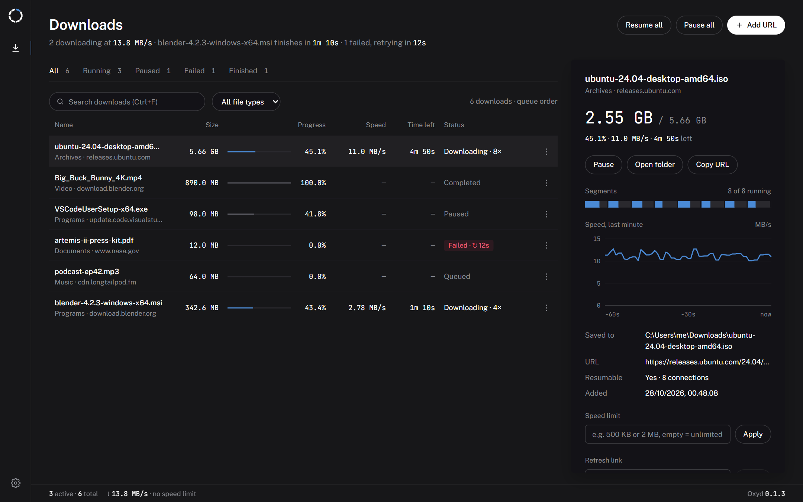
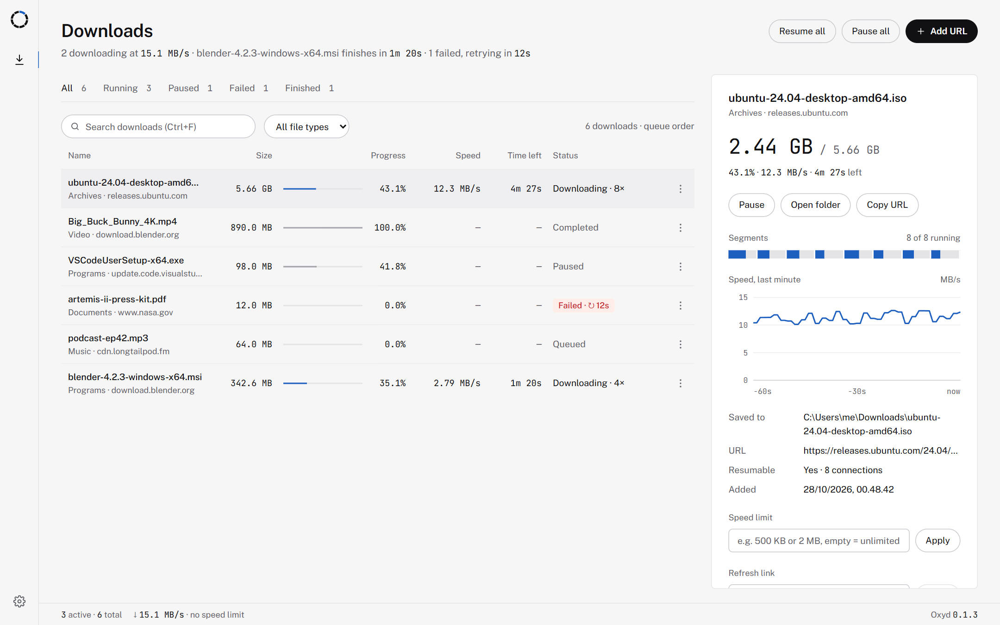
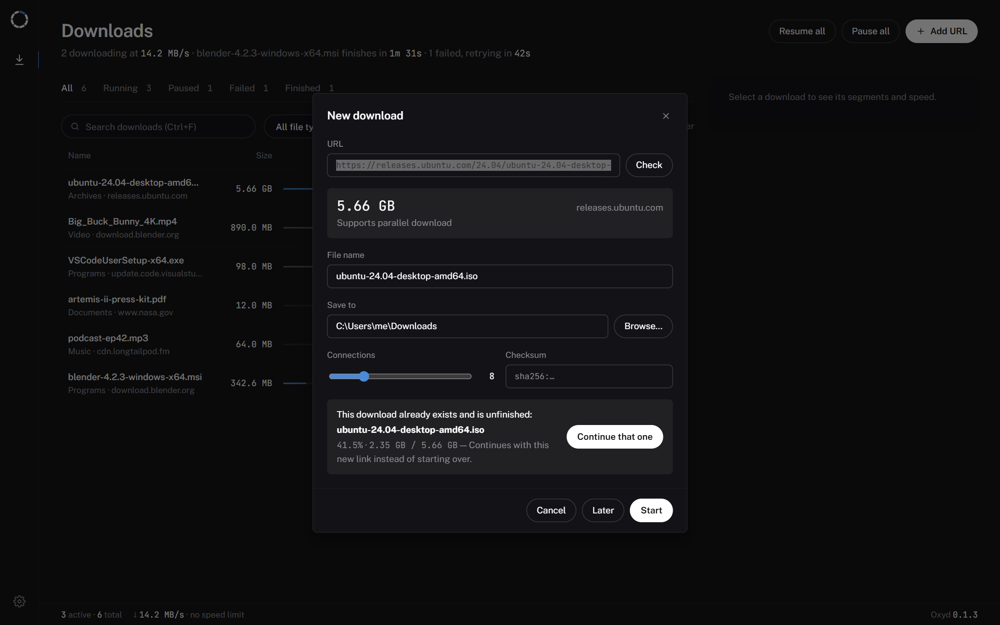
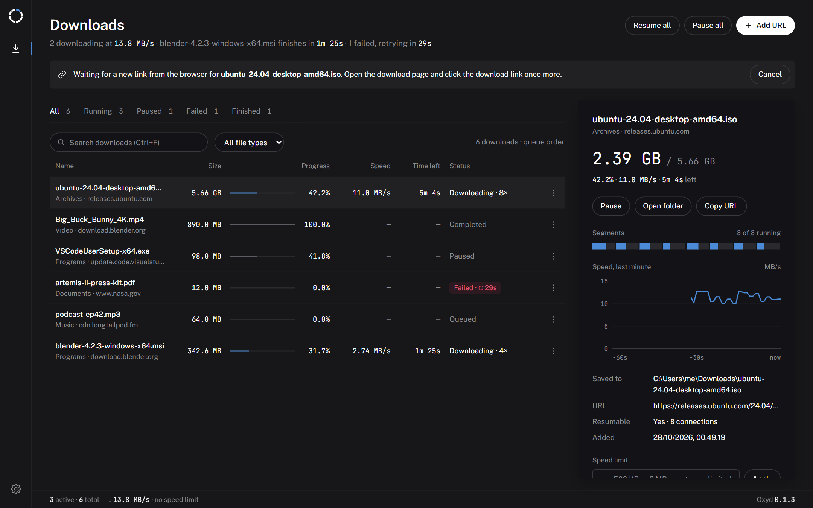
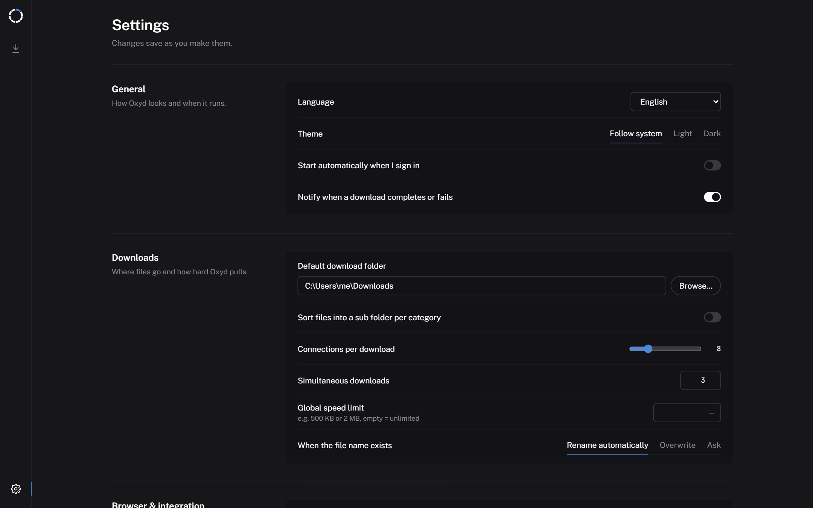

# Oxyd Download Manager

[](https://github.com/YosuaPWH/Oxyd-Download-Manager/actions/workflows/ci.yml)
[](https://github.com/YosuaPWH/Oxyd-Download-Manager/actions/workflows/build.yml)

A fast, lightweight download manager for **Windows and Linux** in the spirit of Internet
Download Manager. Oxyd splits every file into segments that download in parallel, survives
crashes and lost connections, picks up downloads from Chrome, Edge and other Chromium
browsers, and lets you continue a download from where it stopped even after its link has
expired.

<p align="center">
  
</p>

> The screenshots show sample downloads served by the local test server in this repository.

**Highlights**

- Up to **32 parallel connections** per file, with segments that rebalance themselves
- **Resume after anything**: pause, crash, power loss, lost network, app restart
- **Refresh an expired link** from the browser and continue from the last byte, like IDM
- **Browser integration**: Chrome, Edge, Chromium, Brave and Vivaldi downloads are captured,
  cookies and referer included
- **Videos from web pages**: hover a video on YouTube, Instagram, Facebook, TikTok, X and the
  other sites yt-dlp knows and pick a quality, or just the MP3; video and audio download in
  parallel and are merged without re-encoding
- **Small**: the Windows installer is about 5 MB and the app uses about 21 MB in the tray
- **Light and dark** themes that follow your system, in English and Indonesian

## Contents

- [Platforms](#platforms) · [Design](#design) · [Everyday use](#everyday-use)
- [Browser extension](#browser-extension) · [How it works](#how-it-works) · [Install](#install)
- [Build from source](#build-from-source) · [Repository layout](#repository-layout)
- [Documentation](#documentation) · [License](#license)

## Platforms

| | Windows | Linux |
|---|---|---|
| Versions | Windows 10 and 11, 64-bit | 64-bit distributions with GTK 3 and WebKitGTK 4.1 (Ubuntu 22.04+, Debian 12+, Fedora 38+, …) |
| Packages | Setup `.exe`, `.msi` | `.deb`, `.rpm`, `.AppImage` |
| Web view | WebView2 (installed automatically if missing) | WebKitGTK |
| Browsers | Chrome, Edge (plus any Chromium browser through the per-user registration) | Chrome, Chromium, Edge, Brave, Vivaldi |
| Bridge ↔ app | Named pipe `\\.\pipe\oxyd`, owner and SYSTEM only | Unix socket in `$XDG_RUNTIME_DIR`, mode 0600 |
| Stored cookies | Encrypted with DPAPI | In a database only you can read (folder 0700, file 0600) |
| Data folder | `%LOCALAPPDATA%\Oxyd` | `~/.local/share/Oxyd` |

The engine, the interface and the extension are the same code on both systems; only the
parts that talk to the operating system differ.

## Design

Oxyd is a single window built like a monitoring screen: neutral surfaces, colour only on what
is moving, and every figure (sizes, speeds, times) in JetBrains Mono so the digits stack while
they change; the text is Public Sans. Both fonts ship with the app, so it works offline. It
is built with Svelte 5 inside a Tauri 2 shell, so it starts fast and looks the same on
Windows and Linux.

| Dark | Light |
|---|---|
|  |  |

**Layout**

- **Rail**: the Oxyd mark (a ring of eight segments, one lit) with *Downloads* and *Settings*.
  The selected place is marked by a 1px accent line, the same mark every selection uses.
- **Title row**: one line that says what matters now ("2 downloading at 14.2 MB/s · Ubuntu
  finishes in 2m 49s · 1 failed, retrying in 0:24"), *Resume all*, *Pause all* and *Add URL*.
- **Tabs and filters**: *All*, *Running*, *Paused*, *Failed*, *Finished* with counts, a search
  box and a file type filter (Video, Music, Documents, Archives, Programs, Other).
- **Download list**: name with its type and site, size, progress, speed, time left and status.
  Only running downloads are drawn in the accent; a failed one carries a red tag with its retry
  countdown. Each row has a menu button as well as the right-click menu.
- **Detail card**: the selected download's progress in large figures, its actions, the segment
  map (one cell per connection, showing which part of the file each has fetched), the speed
  over the last minute, where it is saved, a per-download speed limit and the link refresh
  controls. On narrow windows the card moves under the list.
- **Settings**: its own page in five sections; every change saves itself.
- **Status bar**: running downloads, the combined speed and the speed limit.

**Theme and language.** *Settings → General* offers *Follow system*, *Light* and *Dark*, and
English or Indonesian. Error messages are translated too, with the technical detail
underneath.

**Keyboard friendly.** The list and every dialog work without a mouse:

| Key | Action |
|---|---|
| ↑ ↓ Home End | Move the selection |
| Enter / Space | Pause a running download, resume a stopped one, open a finished file |
| Delete | Remove the selected download |
| Menu key / right click | Context menu |
| Ctrl+N | New download |
| Ctrl+F | Search by name or URL (Esc clears) |
| Ctrl+, | Settings |
| Esc, Tab | Close the top dialog; focus stays inside it |

**Tray.** Closing the window does not quit Oxyd. It keeps downloading from the tray (*Open*,
*Pause all*, *Resume all*, *Quit*) and the window, with its web view, is only created when you
open it. That is why a tray-only Oxyd needs about 21 MB on Windows. On Linux the tray icon
uses AppIndicator: KDE, Cinnamon, XFCE and Ubuntu show it out of the box; on plain GNOME
(for example Fedora) install the *AppIndicator and KStatusNotifierItem Support* extension.

## Everyday use

### Adding downloads

Click a download link in your browser and Oxyd takes over, or press **Add URL**. A link you
copied just before is filled in and checked right away; pasting a link or pressing Enter
checks it too. Once the check succeeds the *New download* dialog shows the file name, size,
whether the server supports parallel downloads, destination folder, number of connections and
an optional checksum.
Choose **Start**, **Later** (adds it paused) or **Cancel**. If the file name already exists
you can rename automatically or overwrite.

<p align="center">
  
</p>

### Continuing downloads, even with a new link

Links expire and login sessions end. Like IDM, Oxyd can give a stopped download a new link:

1. Select the download and choose **Get a new link from the browser** (detail panel or
   right-click menu). Oxyd opens the page the file came from and waits.
2. Click the download link on that page once more.
3. Oxyd uses the new link, together with the browser's fresh cookies, for the *same*
   download and continues from the last byte. The file is checked to have the same size.

<p align="center">
  
</p>

It also recognises links on its own: a link whose name and size match an unfinished download
is offered as **Continue that one** (see the dialog above) instead of being downloaded again
as `file (1)`. You can also paste a new URL by hand in the detail panel.

### Videos from web pages

Hover a video in the browser and a **Download** button appears in its corner, like IDM's.
Click it for the qualities the page offers (for example *1080p60 · MP4 · H.264 · about
310 MB*), the sound alone as M4A, or MP3; *Best quality* starts right away, before the list
is in. On feeds (Instagram, Facebook, X, Reddit, TikTok) the button belongs to the post the
video is in. The right-click menu has *Download video with Oxyd*, and the popup can send the
current page. Pages are read by [yt-dlp](https://github.com/yt-dlp/yt-dlp), so the same works
for the 1,800+ sites it supports; on other sites the menu lists the video files and HLS/DASH
streams the page loaded. *Add URL* recognises a web page and offers **Find videos on this
page**.

How a video downloads:

- When the streams are plain files (most YouTube, Instagram and Facebook videos), **Oxyd's own
  engine** fetches video and audio *together* over many connections into one part file, so
  they pause, resume and survive restarts like any download. ffmpeg then merges them without
  re-encoding; a file that already has its sound is just renamed, so ffmpeg is not even
  needed. Stream links that expired while paused are read from the page again and the
  download continues where it stopped.
- HLS and fragmented DASH streams, or streams a site refuses to Oxyd's engine, are downloaded
  by yt-dlp itself (several fragments at once) and shown with the same progress.

Nothing extra is installed up front: yt-dlp (and deno, which yt-dlp needs for YouTube) are
downloaded the first time a video needs them, ffmpeg the first time something has to be merged
or converted (Linux uses the system's ffmpeg when it has one). Each is checked against the
SHA-256 its release publishes and kept in Oxyd's data folder. yt-dlp is updated once a day,
because sites change often. *Settings → Videos from the web* shows the tools, updates yt-dlp
on request and accepts your own yt-dlp or ffmpeg.

Download only what you have the right to: many sites' terms forbid downloading their videos.

### Queue, limits and schedule

- Run up to 3 downloads at once by default (1 to 20); the rest wait in the queue, and you can
  move items up or down from the context menu.
- Limit the speed globally or per download (for example `500 KB` or `2 MB`); the limit can be
  changed while a download runs.
- Failed downloads that were only unlucky (network down, server busy) retry by themselves,
  waiting 30 seconds and doubling up to 10 minutes, and show a countdown. Expired links and
  missing files do not retry.
- *Settings → Schedule* starts the queue and pauses everything at chosen times, and can put
  the computer to sleep or shut it down when the queue finishes.

### Settings

<p align="center">
  
</p>

| Tab | What you can set |
|---|---|
| General | Language, theme, start automatically when you sign in, notifications |
| Downloads | Default folder, a sub folder per category, connections per download (1–32), simultaneous downloads, global speed limit, what to do with duplicate names |
| Browser & integration | Show the confirmation dialog for browser downloads, watch the clipboard for file links |
| Videos from the web | Which yt-dlp, ffmpeg and deno are used, update yt-dlp now or every day, your own yt-dlp or ffmpeg |
| Schedule | Start and stop times, action when the queue finishes |
| Network | HTTP, HTTPS or SOCKS5 proxy |

## Browser extension

A Manifest V3 extension for Chrome, Edge and other Chromium browsers sends downloads to Oxyd.
The extension only talks to the app through a small native helper (`oxyd-bridge`), and no
network port is opened. Firefox is not supported yet.

- **Captures** downloads by file type, with a minimum size of 1 MB by default; blob and data
  URLs are always left to the browser. Cookies (including HttpOnly), referer and user agent
  are passed along so sites that need a login still work.
- **Never loses a download.** The browser download is paused while Oxyd is asked; it is only
  cancelled once Oxyd accepted it, and resumed in the browser if Oxyd does not answer
  within 3 seconds.
- **Right-click a link** and choose *Download with Oxyd*; press **Alt+Shift+O** to let the
  next download stay in the browser.
- **Download button on videos** (see [Videos from web pages](#videos-from-web-pages)). It can
  be switched off in the popup. To list the streams of pages yt-dlp does not know, the
  extension notes which responses a tab received were video, audio or HLS/DASH manifests
  (`webRequest`, read-only); that list stays in the browser session.
- The popup shows whether the app is reachable and lets you switch capturing off, change the
  minimum size, the captured file types and the domains that should be left alone.

| Captured by default | Extensions |
|---|---|
| Archives | zip rar 7z tar gz bz2 xz tgz zst iso img bin cab |
| Programs | exe msi msix apk dmg deb rpm jar |
| Video | mp4 mkv avi mov wmv flv webm m4v mpg mpeg 3gp |
| Music | mp3 wav flac aac ogg m4a wma opus |
| Documents | pdf doc docx xls xlsx ppt pptx epub |

An empty list captures everything. Through *Add URL* or the right-click menu any file type
can be downloaded.

## How it works

```
Browser extension ──stdio──▶ oxyd-bridge ──pipe / socket──▶ Oxyd (Tauri)
 (Chrome, Edge, …) ◀──────               ◀───────────────    ├─ UI (web view, Svelte)
                                                             ├─ queue and scheduler
                                                             └─ oxyd-core ─ SQLite + disk
```

The browser starts `oxyd-bridge` (its *native messaging host*) for each message; the bridge
forwards it to the running app over a named pipe on Windows or a Unix socket on Linux, and
starts the app first if needed.

1. **Probe.** Oxyd asks the server for the first bytes with a `Range` request. The answer
   tells it the size, whether ranges work, the ETag and the file name; that same response
   becomes the first segment, so small files need a single request.
2. **Segments.** The file is cut into up to 32 segments (initially at least 1 MiB each), each
   fetched by its own connection and written straight to its offset in a sparse `.oxydpart`
   file. When a connection becomes idle, the segment that will take longest to finish is
   split so the fastest connections help the slowest. Servers without range support fall back
   to one connection.
3. **Durability.** Progress per segment is saved to SQLite every second, after the data was
   flushed to disk, so a crash or power loss never leaves progress ahead of the data. On
   restart unfinished downloads continue where they were; the ETag, modification time and size
   are compared first so a changed file is never stitched together.
4. **Finish.** When all segments are complete the file is optionally verified (`sha256:` or
   `md5:`), renamed from `.oxydpart`, and any cookies stored for the download are erased.
5. **Be polite.** Failed requests retry with exponential backoff and `Retry-After`; when a
   server answers 429 or 503, connections are given up immediately and added back slowly.

**Videos.** The extension sends the page address and that site's cookies; the app reads the
page with yt-dlp (`-J`, cookies through a temporary file only your user can read) and offers a
short list of qualities. The chosen formats' sizes and Range support are checked; plain files
then go through the engine above as one part file with the streams end to end (no segment
crosses from video to audio). At the end the audio is moved out, the part file cut to the
video and ffmpeg merges both (`-c copy`); if that fails or is stopped, the part file is put
back together so no progress is lost. Other streams go to yt-dlp with its own `.part` files.

**Privacy.** Cookies and authorisation headers are kept only while a download needs them and
deleted when it completes. On Windows they are encrypted with DPAPI for your user account; on
Linux the database lives in a folder only your user can open. Links in the log files are
reduced to their host and path, and there is no telemetry.

## Install

Released versions are on the **Releases** page of the repository. Every push to `main` also
builds them: open the latest run of the *Build installer* workflow in the **Actions** tab and
download the Windows or Linux artifact (kept for 30 days).

| File | Platform |
|---|---|
| `Oxyd-Setup-<version>.exe` | Windows setup program |
| `Oxyd-Setup-<version>.msi` | Windows Installer package of the same app |
| `Oxyd-<version>-amd64.deb` | Debian, Ubuntu, Linux Mint, Pop!_OS, … |
| `Oxyd-<version>-x86_64.rpm` | Fedora, RHEL, openSUSE, … |
| `Oxyd-<version>-x86_64.AppImage` | Any other 64-bit distribution, no installation |
| `Oxyd-Extension-<version>.zip` | The unpacked browser extension (same on every system) |
| `SHA256SUMS.txt` | Checksums of all files |

### Windows

| | `.exe` (NSIS) | `.msi` |
|---|---|---|
| For | Normal use on your own PC | IT deployment: Group Policy, Intune, `msiexec` |
| Installs | Per user, **no administrator rights** | For all users in `Program Files`, needs administrator rights |
| Browser helper | Registered for your user in the registry | Registered machine-wide (HKLM) for Chrome and Edge |
| Uninstall | Removes the program, the registration and the autostart entry | Removes the program and the machine-wide registration |
| Silent install | `Oxyd-Setup-<version>.exe /S` | `msiexec /i Oxyd-Setup-<version>.msi /qn` |

Pre-release versions such as `0.2.0-beta.1` only come as `.exe`, because MSI versions must be
numeric. Neither installer is code signed yet, so Windows SmartScreen may ask for
confirmation. WebView2 (part of Windows 11) is installed automatically if it is missing.

### Linux

```bash
sudo apt install ./Oxyd-<version>-amd64.deb      # Debian, Ubuntu and derivatives
sudo dnf install ./Oxyd-<version>-x86_64.rpm     # Fedora, RHEL
```

The packages pull in WebKitGTK and the tray library, put the app in the application menu and
`oxyd-bridge` in `/usr/bin`, and register the helper system-wide for Chrome, Chromium and
Edge (`/etc/opt/chrome`, `/etc/chromium`, `/etc/opt/edge`).

The AppImage needs no installation:

```bash
chmod +x Oxyd-<version>-x86_64.AppImage
./Oxyd-<version>-x86_64.AppImage
```

It needs FUSE 2 (`sudo apt install libfuse2`, called `libfuse2t64` on Ubuntu 24.04). On its
first start it copies `oxyd-bridge` to `~/.local/share/Oxyd/bin`, because the browser cannot
start a program inside the AppImage. Keep the AppImage where it is; if you move it, start it
once from the new place so the helper finds it again.

Whatever the package, Oxyd also registers the helper for your user in
`~/.config/<browser>/NativeMessagingHosts` every time it starts, for each of Chrome, Chromium,
Edge, Brave and Vivaldi that is installed. Browsers installed as Flatpak or Snap cannot start
native helpers and are not supported.

### Extension

Unzip the extension (or use `extension/build` after building it), open `chrome://extensions`
(or `edge://extensions`, `brave://extensions`, …), turn on *Developer mode*, choose *Load
unpacked* and select the folder. Its ID is always `gnihamodjbioaennpopmldmjdecbmfpl`, which is
the one the installers allow to talk to the helper.

### Publishing a release

For maintainers: raise the version in `app/src-tauri/tauri.conf.json`,
the workspace `Cargo.toml` and both `package.json` files, commit, then

```bash
git tag v0.1.0
git push origin v0.1.0
```

The workflow checks that the tag matches the app version, builds the Windows and Linux
packages in parallel and publishes a GitHub Release with all of them, the extension zip and
one `SHA256SUMS.txt`. Tags with a suffix such as `v0.2.0-beta.1` become pre-releases.

### Data

| | Windows | Linux |
|---|---|---|
| Downloads and settings | `%LOCALAPPDATA%\Oxyd\oxyd.db` | `~/.local/share/Oxyd/oxyd.db` |
| Logs | `%LOCALAPPDATA%\Oxyd\logs\` | `~/.local/share/Oxyd/logs/` |
| Browser helper | `%LOCALAPPDATA%\Oxyd\native-host\` and HKCU | `~/.config/<browser>/NativeMessagingHosts/` |
| yt-dlp, ffmpeg, deno | `%LOCALAPPDATA%\Oxyd\tools\` | `~/.local/share/Oxyd/tools/` |

## Build from source

Requirements: Rust stable and Node.js 22 or newer, plus

- **Windows** 10/11 (64-bit) with the MSVC toolchain;
- **Linux**: the Tauri system libraries. On Debian or Ubuntu:

  ```bash
  sudo apt install build-essential libwebkit2gtk-4.1-dev libayatana-appindicator3-dev librsvg2-dev patchelf
  ```

  On Fedora: `sudo dnf install webkit2gtk4.1-devel libappindicator-gtk3-devel librsvg2-devel patchelf`.

```bash
cargo test --workspace                 # engine, protocol and bridge tests
cd app && npm install && npx tauri dev # desktop app with hot reload
cd extension && npm install && npm run build   # extension into extension/build
```

Packages:

```bash
# Windows
powershell -ExecutionPolicy Bypass -File scripts/build-installer.ps1
# -> target/release/bundle/nsis/Oxyd Download Manager_<version>_x64-setup.exe
# -> target/release/bundle/msi/Oxyd Download Manager_<version>_x64_en-US.msi

# Linux (pass e.g. "deb" to build only one kind)
bash scripts/build-linux.sh
# -> target/release/bundle/deb/*.deb, rpm/*.rpm, appimage/*.AppImage
```

Useful during development:

```bash
cargo run -p test-server               # local server: ranges, throttling, drops, 429/503, ETags, cookies
cargo run -p oxyd-cli -- download "http://127.0.0.1:8787/file/104857600?rate=1048576" -c 8
cd app && npm run dev                  # UI alone in a browser with a mock backend
powershell -File scripts/register-dev.ps1   # Windows: register a local oxyd-bridge.exe (-Unregister to remove)
```

On Linux a development build registers its own `oxyd-bridge` for your user when it starts.

| Variable | Effect |
|---|---|
| `OXYD_DATA_DIR` | Moves the data folder |
| `OXYD_LOG=debug` | Raises the log level |
| `OXYD_PIPE` | Another pipe name (Windows) or socket path (Linux) between bridge and app; the default socket is `$XDG_RUNTIME_DIR/oxyd.sock` |
| `OXYD_APP` | The app the bridge starts when it is not running |

## Repository layout

| Folder | Contents |
|---|---|
| `crates/oxyd-core` | Download engine: probe, segments, workers, limiter, SQLite, queue and manager; `media/` for videos from web pages (yt-dlp, ffmpeg, tool downloads) |
| `crates/oxyd-cli` | `oxyd-cli`, a command line front end for the engine |
| `crates/oxyd-protocol` | Message types, framing, the secured named pipe (Windows) and Unix socket (Linux) |
| `crates/oxyd-bridge` | `oxyd-bridge`, the native messaging host |
| `app/` | Tauri app (`src-tauri/`) and the Svelte interface (`src/`) |
| `extension/` | Chromium extension (TypeScript, esbuild) |
| `installer/`, `scripts/` | NSIS hooks, WiX fragment for the MSI, Windows and Linux package builds, dev registration, kill/resume test |
| `test-server/` | Local HTTP server used by the tests and benchmarks |

## Documentation

- [docs/IMPROVEMENTS.md](docs/IMPROVEMENTS.md): measured speed and memory improvements,
  reliability and security fixes, and what is still open.
- [docs/PRD.md](docs/PRD.md) and [docs/PLAN.md](docs/PLAN.md): the product requirements and
  the implementation plan (written in Indonesian).

## License

Released under the [MIT License](LICENSE).
