# Oxyd Download Manager

A fast, lightweight download manager for **Windows and Linux** in the spirit of Internet
Download Manager. Oxyd downloads files in parallel segments when the server supports it,
resumes after crashes and lost connections, and can refresh an expired download link. Files
from Firefox and Chromium browsers, videos from web pages, torrents and FTP downloads share
a list with scheduled queues.

[Download a release](https://github.com/YosuaPWH/Oxyd-Download-Manager/releases/latest) ·
[Build from source](#build-from-source) · [Set up the browser extension](#extension)

<p align="center">
  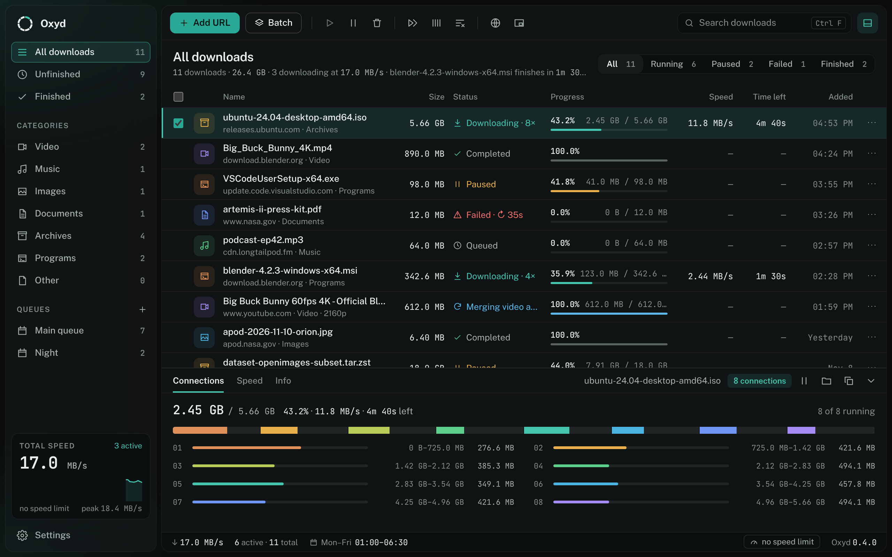
</p>

> The screenshots show sample downloads served by the local test server in this repository.

**Highlights**

- Up to **32 parallel connections** per file, with segments that rebalance themselves
- **Resume after anything**: pause, crash, power loss, lost network, app restart
- **Refresh an expired link** from the browser and continue from the last byte, like IDM
- **Browser integration**: Firefox and Chromium browsers can hand downloads to Oxyd.
  Settings shows the native host status, extension version and last contact for Chrome/Chromium,
  Edge and Firefox
- **Videos from web pages**: hover a video on YouTube, Instagram, Facebook, TikTok, X and the
  other sites yt-dlp knows and pick a quality, or just the MP3; video and audio download in
  parallel and are merged without re-encoding
- **Torrents and FTP**: magnet links, `.torrent` files and `ftp://` links share the download
  list. The BitTorrent session starts with the first torrent
- **Named queues**, each with its own concurrency, speed limit and schedule
- **Site grabber**: list every file a page links to and pick what to download
- **Tools** for finished files: convert, make smaller, ZIP
- **Progress windows** and an always-on-top **mini window** that takes dropped links
- **Batch downloads**: paste many links or write `file[001-100].zip`; drag links onto the
  window
- **Work on many downloads at once**: multi-select, sortable columns, one lane per connection
- **Light and dark** themes that follow your system, six accent colours, in English and
  Indonesian

## Contents

- [Platforms](#platforms) · [Design](#design)
- [Everyday use](#everyday-use): [adding](#adding-downloads) · [batch](#many-downloads-at-once) ·
  [new link](#continuing-downloads-even-with-a-new-link) · [videos](#videos-from-web-pages) ·
  [queues](#queues) · [torrents and FTP](#torrents-and-ftp) ·
  [grabber](#grabbing-the-links-of-a-page) · [tools](#tools-for-finished-files) ·
  [progress and mini windows](#progress-and-mini-windows) ·
  [limits and schedule](#limits-retries-and-schedule) · [settings](#settings)
- [Browser extension](#browser-extension) · [How it works](#how-it-works) · [Install](#install)
- [Build from source](#build-from-source) · [Windows release smoke test](#windows-release-smoke-test) ·
  [Repository layout](#repository-layout)
- [Documentation](#documentation) · [License](#license)

## Platforms

| | Windows | Linux |
|---|---|---|
| Versions | Windows 10 and 11, 64-bit | 64-bit distributions with GTK 3 and WebKitGTK 4.1 (Ubuntu 22.04+, Debian 12+, Fedora 38+, …) |
| Packages | Setup `.exe`, `.msi` | `.deb`, `.rpm`, `.AppImage` |
| Web view | WebView2 (installed automatically if missing) | WebKitGTK |
| Browsers | Chrome, Edge, Firefox 140+ | Chrome, Chromium, Edge, Brave, Vivaldi, Firefox 140+ |
| Bridge ↔ app | Named pipe `\\.\pipe\oxyd`, owner and SYSTEM only | Unix socket in `$XDG_RUNTIME_DIR`, mode 0600 |
| Stored cookies | Encrypted with DPAPI | In a database only you can read (folder 0700, file 0600) |
| Data folder | `%LOCALAPPDATA%\Oxyd` | `~/.local/share/Oxyd` |

The engine, the interface and the extension are the same code on both systems; only the
parts that talk to the operating system differ.

## Design

Oxyd is a single window: a sidebar for where you are, a calm sheet for the data, and colour
only on what is moving. Every figure (sizes, speeds, times) is set in JetBrains Mono so the
digits stack while they change; the text is Public Sans. Both fonts ship with the app, so it
works offline. It is built with Svelte 5 inside a Tauri 2 shell, so it starts fast and looks
the same on Windows and Linux.

The layout follows the direction of [Prism](https://github.com/YosuaPWH/prism-download-manager)
(sidebar, action toolbar, bottom pane with one lane per connection) while staying a single
light window. The feature analysis and the mockups it was built from are in
[docs/design/redesign-board.html](docs/design/redesign-board.html).

| Dark | Light |
|---|---|
|  | 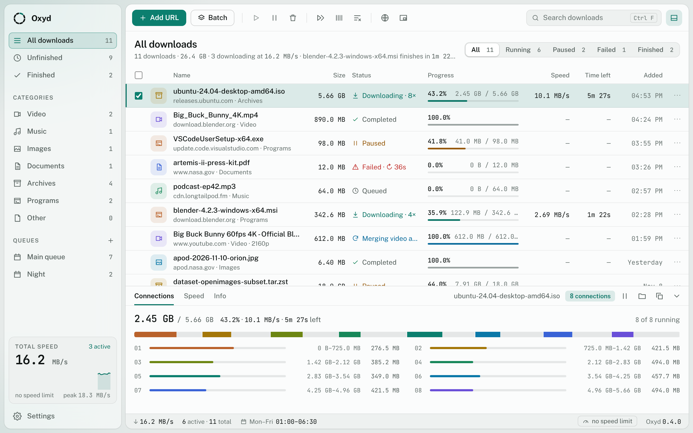 |

**Layout**

- **Sidebar**: the Oxyd download mark, *All downloads*,
  *Unfinished* and *Finished*, the seven file types with their counts, the queues with what
  still waits in each, and the total speed with its last minute as a sparkline. On narrow
  windows it shrinks to icons.
- **Toolbar**: *Add URL*, *Batch*, resume / pause / remove for the selected downloads, resume
  all, pause all, clear finished, the link grabber, the mini window, the search box and the
  switch for the bottom pane.
- **Title row**: what you are looking at, one line that says what matters now ("2 downloading
  at 14.2 MB/s · Ubuntu finishes in 2m 49s · 1 failed, retrying in 0:24") and the status
  filter (*All*, *Running*, *Paused*, *Failed*, *Finished*) with counts.
- **Download list**: file type, name and site (torrents and FTP say so), size, status,
  progress, speed, time left and when it was added. Click a column header to sort by it; a third click returns to queue
  order. Select several rows with Ctrl or Shift click, the checkboxes or Ctrl+A and act on
  all of them at once. Rows are 44px, or 32px in *compact* density.
- **Bottom pane** (Ctrl+I): *Connections* shows the file map and one lane per connection
  with its byte range and what it still has to fetch, each in its own colour from copper to
  patina (a torrent or an FTP download is one lane); *Speed* shows the last minute with the current, average and peak speed; *Info*
  holds the path, the URL, a per-download speed limit and the link refresh controls.
- **Status bar**: the combined speed, running downloads, the schedule and the speed limit,
  which can be switched on and off right there.
- **Settings**: its own window; every change saves itself.

**Appearance.** *Settings → Appearance* offers six accent colours (patina, copper, azure,
violet, rose, graphite), comfortable or compact rows, and a switch for the translucent
sidebar for weak GPUs and remote desktops. Status colours (finished, paused, failed) never
follow the accent.

**Theme and language.** *Settings → Appearance* previews system, light and dark themes.
Choose the system language, English or Indonesian in *Settings → General*. Error messages are translated too, with the technical detail
underneath.

**Keyboard friendly.** The list and every dialog work without a mouse:

| Key | Action |
|---|---|
| ↑ ↓ Home End | Move the selection |
| Enter / Space | Pause a running download, resume a stopped one, open a finished file |
| Ctrl / Shift + click, Shift + ↑ ↓ | Select several downloads |
| Ctrl+A | Select every download in the list |
| Delete | Remove the selected downloads |
| Menu key / right click | Context menu |
| Ctrl+N | New download |
| Ctrl+B | Batch download |
| Ctrl+G | Grab the links of a page |
| Ctrl+V | Download the links on the clipboard (outside a text field) |
| Ctrl+I | Show or hide the bottom pane |
| Ctrl+F | Search by name or URL (Esc clears) |
| Ctrl+, | Settings |
| Esc, Tab | Close the top dialog; focus stays inside it |

**Tray.** Closing the main window keeps Oxyd running in the tray (*Open*, *Pause all*,
*Resume all*, *Quit*). Opening the window loads its web view. On Linux the tray icon uses
AppIndicator. KDE, Cinnamon, XFCE and Ubuntu show it out of the box. On plain GNOME, install
the *AppIndicator and KStatusNotifierItem Support* extension.

## Everyday use

### Adding downloads

Click a download link in your browser and Oxyd takes over, or press **Add URL**. A link you
copied just before is filled in and checked right away; pasting a link or pressing Enter
checks it too. Once the check succeeds the *New download* dialog shows the file name, size,
whether the server supports parallel downloads, destination folder, number of connections and
an optional checksum.
Choose **Start**, **Later** (adds it paused) or **Cancel**. If the file name already exists
you can rename automatically or overwrite.

<p align="center">
  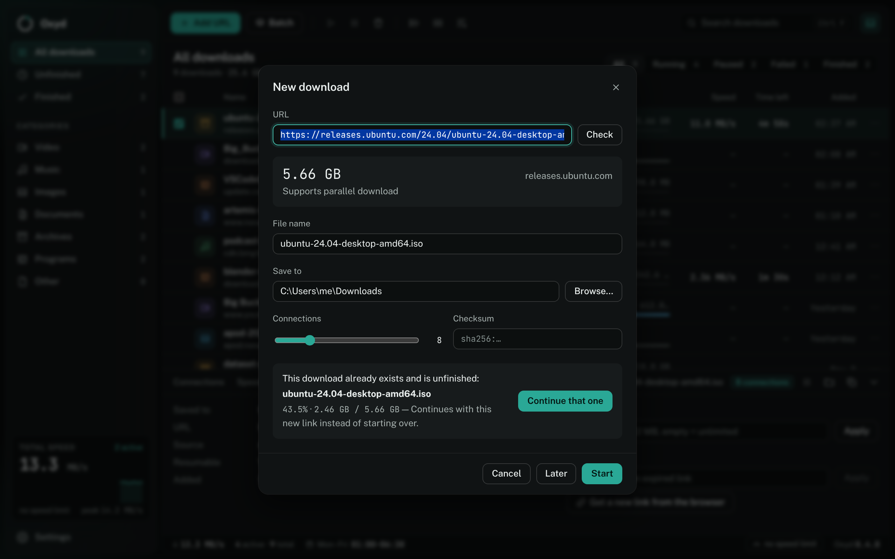
</p>

### Many downloads at once

**Batch** (Ctrl+B) takes any number of links, one per line. A range in square brackets is
expanded: `photo-[001-120].jpg` becomes 120 links and keeps its leading zeros, `[a-c]` runs
through letters and `[0-100:10]` counts in steps. Every resulting link can be unticked before
it is added, and repeated links are skipped. A batch holds at most 1000 links.

<p align="center">
  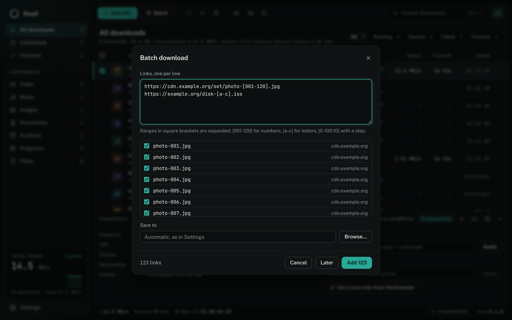
</p>

You can also **drag links** from the browser onto the window, or press **Ctrl+V** with links
on the clipboard: one link opens *New download*, several open the batch.

### Continuing downloads, even with a new link

Links expire and login sessions end. Like IDM, Oxyd can give a stopped download a new link:

1. Select the download and choose **Get a new link from the browser** (detail panel or
   right-click menu). Oxyd opens the page the file came from and waits.
2. Click the download link on that page once more.
3. Oxyd uses the new link, together with the browser's fresh cookies, for the *same*
   download and continues from the last byte. The file is checked to have the same size.

<p align="center">
  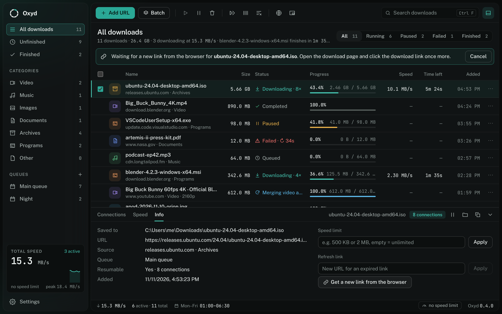
</p>

It also recognises links on its own: a link whose name and size match an unfinished download
is offered as **Continue that one** (see the dialog above) instead of being downloaded again
as `file (1)`. You can also paste a new URL by hand in the detail panel.

### Videos from web pages

Hover a video in the browser and a **Download** button appears in its corner, like IDM's.
Click it for the qualities the page offers (for example *1080p60 · MP4 · H.264 · about
310 MB*), the sound alone as M4A, or MP3; *Best quality* starts right away, before the list
is in. On feeds (Instagram, Facebook, X, Reddit, TikTok) the button belongs to the post the
video is in. The right-click menu has *Download video with Oxyd*, and the popup can send the
current page. Pages are read by [yt-dlp](https://github.com/yt-dlp/yt-dlp), so the same works
for the 1,800+ sites it supports; on other sites the menu lists the video files and HLS/DASH
streams the page loaded. *Add URL* recognises a web page and offers **Find videos on this
page**.

How a video downloads:

- When the streams are plain files (most YouTube, Instagram and Facebook videos), **Oxyd's own
  engine** fetches video and audio *together* over many connections into one part file, so
  they pause, resume and survive restarts like any download. ffmpeg then merges them without
  re-encoding; a file that already has its sound is just renamed, so ffmpeg is not even
  needed. Stream links that expired while paused are read from the page again and the
  download continues where it stopped.
- HLS and fragmented DASH streams, or streams a site refuses to Oxyd's engine, are downloaded
  by yt-dlp itself (several fragments at once) and shown with the same progress.

Nothing extra is installed up front: yt-dlp (and deno, which yt-dlp needs for YouTube) are
downloaded the first time a video needs them, ffmpeg the first time something has to be merged
or converted (Linux uses the system's ffmpeg when it has one). Oxyd verifies managed tools
against their release checksums and stores them in its data folder. Open
*Settings → Videos from the web* to install the tools, check their versions, set a custom
yt-dlp or ffmpeg path, or turn daily yt-dlp updates on or off.

Download only what you have the right to: many sites' terms forbid downloading their videos.

### Queues

The sidebar lists the queues. Every download belongs to one; a queue runs its own number of
downloads at once, can cap their combined speed and has its own schedule, so a *Night* queue
can run two downloads at 2 MB/s from 23:00 while the main queue stays as it is. **+** makes a
queue, the pencil edits it, and *Move to queue* in the right-click menu moves the selected
downloads. Deleting a queue moves its downloads back to the main queue.

<p align="center">
  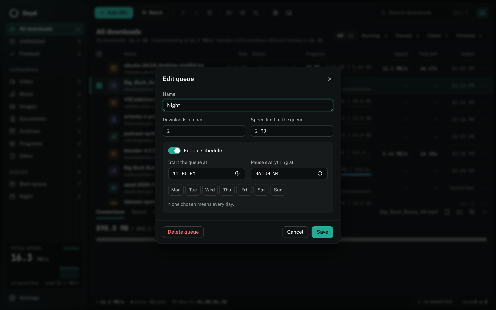
</p>

### Torrents and FTP

Paste a **magnet link** into *Add URL*, drop it on the window, or open a `.torrent` file with
the magnet button of the dialog. A torrent is one row of the list: it can wait in a queue, be
paused and resumed, and data that is already on disk is checked and kept. Oxyd stops when a
torrent is complete; it uploads to other peers while it downloads, as the protocol expects,
but does not keep seeding. All files of a torrent are downloaded.

`ftp://` links work through *Add URL* and the batch dialog: plain FTP in passive mode over one
connection, resumed from the last byte with `REST`. FTPS is not supported.

BitTorrent needs IPv6 sockets to exist on the system (they do by default on Windows and
Linux); where they are switched off, a torrent fails with a message that says so.

### Grabbing the links of a page

**Grab links from a page** (the globe in the toolbar, Ctrl+G) reads a page and lists every
link to a video, music file, image, document, archive or program, grouped by type. It can
follow the pages the start page links to, one or two levels deep, staying on the same site
by default, and reads at most 40 pages. The page is sent as the referer when the files are
downloaded. Pages are read as plain HTML, so links a script adds after loading are not seen.

<p align="center">
  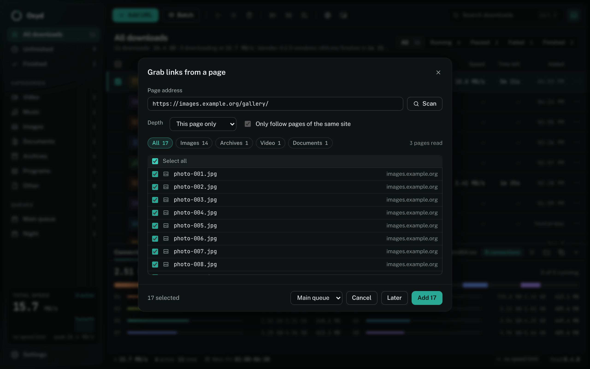
</p>

### Tools for finished files

Right-click one or more finished downloads and choose **Tools**:

- **Convert** to MP4, MKV (no re-encoding), WebM, MP3 or M4A;
- **Make smaller**: re-encode a video so it fits a size in megabytes;
- **ZIP** the selected files and folders into one archive.

A job shows its progress at the bottom right and can be cancelled; the original file is never
replaced. The media tools use the ffmpeg Oxyd already manages for videos, one job at a time.

<p align="center">
  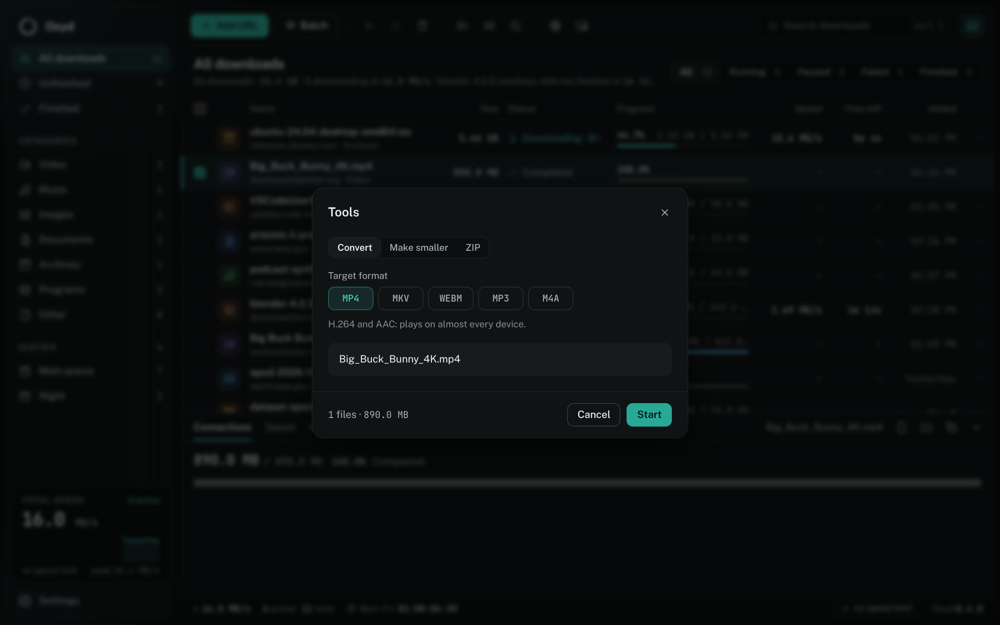
</p>

### Progress and mini windows

Every download that starts right away opens a small **progress window** with its speed, time
left, segment map and *Pause* / *Cancel* (*Open* when it is done). At most six are open at
once, and *Settings → Downloads* switches them off; *Show progress window* in the right-click
menu opens one by hand. Resize a progress window to use that size for future downloads, even
after restarting Oxyd. A window that could not be opened is tried again every two seconds while
its download runs, and one you closed stays closed.

The **mini window** (toolbar) stays on top of other windows: total speed, the download that
finishes next, and a place to drop links, which start at once. Each of these windows is a web
view of its own and costs memory while it is open.

| Progress window | Mini window |
|---|---|
| 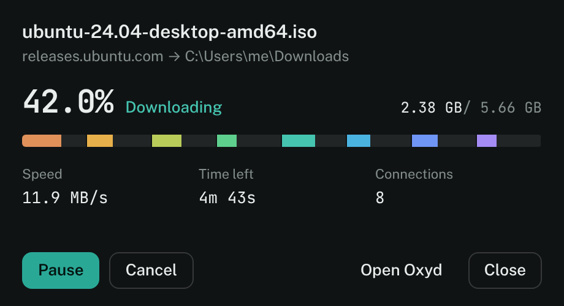 | 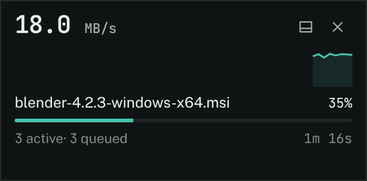 |

### Limits, retries and schedule

- The main queue runs up to 3 downloads at once by default (1 to 20); the rest wait, and you
  can move items up or down from the context menu. Other [queues](#queues) have their own
  number.
- Limit the speed globally or per download (for example `500 KB` or `2 MB`); the limit can be
  changed while a download runs.
- Failed downloads that were only unlucky (network down, server busy) retry by themselves,
  waiting 30 seconds and doubling up to 10 minutes, and show a countdown. Expired links and
  missing files do not retry.
- The speed limit chip in the status bar switches the global limit on and off and offers
  common values, without opening Settings.
- *Settings → Schedule* starts the main queue and pauses it at chosen times, on the days of
  the week you pick (none picked means every day); every other queue has the same schedule
  of its own in its dialog. The day only decides the start: a stop after midnight still ends
  what the evening before began. When every queue has finished, Oxyd can put the computer to
  sleep or shut it down.
- A finished download shows *Open* and *Open folder* at the bottom right and plays a short
  tone, which *Settings → Notifications & sounds* can turn off.

### Settings

<p align="center">
  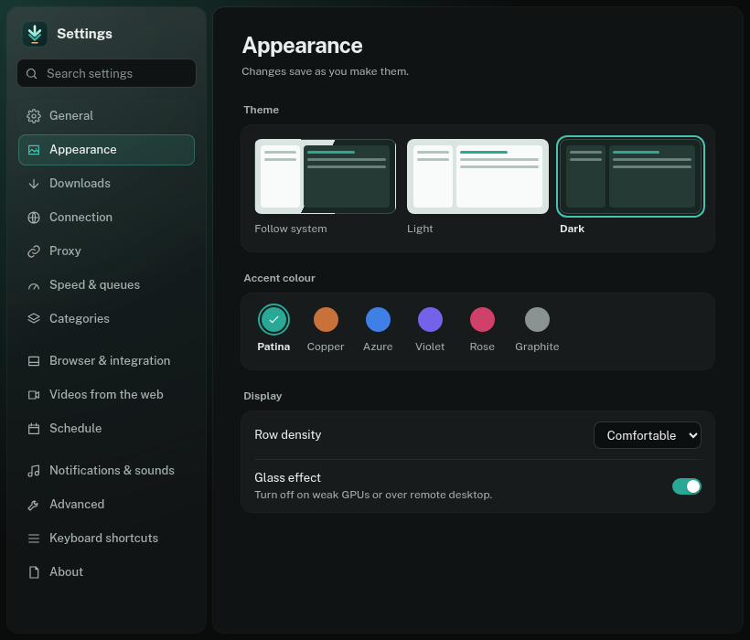
</p>

Search by a section or preference name in the sidebar. Changes save automatically, and the
main window picks up appearance and language changes while Settings is open.

| Section | Controls |
|---|---|
| General | Language, startup, clipboard monitoring |
| Appearance | Theme previews, accent colour, row density, glass effect |
| Downloads | Default folder, duplicate names, progress windows |
| Connection and Proxy | Connections per download (1–32), connect and read timeouts, HTTP version, custom User-Agent, HTTP/HTTPS/SOCKS5 proxy and host exceptions |
| Speed & queues and Schedule | Global limit, queue editor, start and stop times, completion action |
| Categories | Subfolder sorting and optional per-category folders |
| Browser & integration | Native host status by browser, extension version and last contact, bridge repair, optional desktop-managed capture filters and video button |
| Videos from the web | Install yt-dlp, ffmpeg and Deno, set tool paths, choose subtitles, metadata, thumbnails, chapters, and YouTube SponsorBlock |
| Notifications & sounds | Desktop notifications and completion tone |
| Security | Optional local scans using Microsoft Defender on Windows or ClamAV on Linux |
| Advanced | Settings and download list backups, diagnostic ZIP, application data folder |
| Keyboard shortcuts and About | Shortcut reference, version, license, GitHub releases and source code |

**Download list backup.** Exports include portable URLs, names and timestamps. Import adds paused
entries and skips matching URLs and names. Files, browser cookies, and partial downloads are
kept outside the backup. Diagnostic ZIPs contain version and state summaries.

**HTTP/3.** HTTP/1.1 is the default. Automatic mode can negotiate HTTP/2. For an experimental
Windows build, pass `-Http3` to `scripts/build-installer.ps1`. Then select a direct connection
and HTTP/3 in Settings. Use it with servers that support QUIC.

## Browser extension

The extension sends downloads and videos from Chromium browsers and Firefox through the
local `oxyd-bridge` native messaging host. In Firefox, Oxyd can accept a compatible
attachment link before Firefox opens its Save dialog. Firefox also checks its download list
for other eligible downloads. With automatic capture, Firefox handles the download when
Oxyd is closed. Use *Download with Oxyd* from the link menu to start the app explicitly.

- Cookies and login headers are only sent to the site they came from: after a redirect to
  another site (a CDN) they are left out.
- **Captures** downloads by file type, with a minimum size of 1 MiB by default. Blob and data
  URLs stay in the browser. Oxyd can use the browser's cookies, referer and user agent to
  download from sites that require a login.
- **Browser fallback.** When the extension intercepts a response, it lets that response
  continue if Oxyd declines or is unreachable. When an existing download is paused for
  handoff, the extension resumes it in the browser if Oxyd does not accept it.
- **Right-click a link** and choose *Download with Oxyd*; press **Alt+Shift+O** to let the
  next download stay in the browser.
- **Download button on videos** (see [Videos from web pages](#videos-from-web-pages)). The
  **×** next to it hides the button for that video or post until the page is loaded again;
  other videos keep theirs, and *Download video with Oxyd* in the right-click menu still
  works for a hidden one. In fullscreen the button and its menu are not shown at all, also
  for a player inside a frame. In the extension popup, **Video overlay** lets you choose an
  icon-only button and a player corner. Each site's settings also apply to players embedded
  on that site. To list streams on pages yt-dlp does not know, the extension notes which
  responses a tab received were video, audio or HLS/DASH manifests. That list stays in the
  browser session.
- The popup shows whether the app is reachable and lets you switch capturing off, change the
  minimum size, the captured file types and the domains that should be left alone.

| Captured by default | Extensions |
|---|---|
| Archives | zip rar 7z tar gz bz2 xz tgz zst iso img bin cab |
| Programs | exe msi msix apk dmg deb rpm jar |
| Video | mp4 mkv avi mov wmv flv webm m4v mpg mpeg 3gp |
| Music | mp3 wav flac aac ogg m4a wma opus |
| Documents | pdf doc docx xls xlsx ppt pptx epub |

An empty extension filter accepts any file extension. Enable *Manage capture from Oxyd* in
*Settings → Browser & integration* to apply desktop filters for size, extensions, MIME types
and excluded domains, plus the overlay switch and minimum video duration. The extension reads
the desktop profile when it starts, when a download is evaluated, or when the popup is opened.
Through *Add URL* or the right-click menu any file type can be downloaded.

## How it works

```
Browser extension ──stdio──▶ oxyd-bridge ──pipe / socket──▶ Oxyd (Tauri)
 (Chrome, Edge, …) ◀──────               ◀───────────────    ├─ UI (web view, Svelte)
                                                             ├─ queue and scheduler
                                                             └─ oxyd-core ─ SQLite + disk
```

The browser starts `oxyd-bridge` (its *native messaging host*) for each message. The bridge
forwards the message over a named pipe on Windows or a Unix socket on Linux. Chromium
download handoffs and explicit download requests can start the app. Connection checks and
automatic capture in Firefox use the running app when available.

1. **Probe.** Oxyd asks the server for the first bytes with a `Range` request. The answer
   tells it the size, whether ranges work, the ETag and the file name; that same response
   becomes the first segment, so small files need a single request.
2. **Segments.** The file is cut into up to 32 segments (initially at least 1 MiB each), each
   fetched by its own connection and written straight to its offset in a sparse `.oxydpart`
   file. When a connection becomes idle, the segment that will take longest to finish is
   split so the fastest connections help the slowest. Servers without range support fall back
   to one connection.
3. **Durability.** Progress per segment is saved to SQLite every second, after the data was
   flushed to disk, so a crash or power loss never leaves progress ahead of the data. On
   restart unfinished downloads continue where they were; the ETag, modification time and size
   are compared first so a changed file is never stitched together.
4. **Finish.** When all segments are complete the file is optionally verified (`sha256:` or
   `md5:`), renamed from `.oxydpart`, and any cookies stored for the download are erased.
5. **Be polite.** Failed requests retry with exponential backoff and `Retry-After`; when a
   server answers 429 or 503, connections are given up immediately and added back slowly.

**Queues.** Each queue counts its own running downloads and starts the next one that waits
in it, so a full main queue never holds back another queue. A queue with a speed limit shares
one token bucket between its downloads, on top of the global limit and the per-download one.

**FTP.** A small client of Oxyd's own: it logs in (anonymous unless the link carries a name),
asks for the size, opens a passive data connection to the address of the control connection
(servers behind NAT announce addresses that cannot be reached) and writes into the same
`.oxydpart` file, checkpointed like an HTTP download, so pause and crash recovery are the
same; resuming sends `REST` with the bytes already on disk.

**Torrents.** [librqbit](https://github.com/ikatson/rqbit) does the transfer; Oxyd maps its
state onto a row of the list. The session starts with the first torrent and finds peers
through DHT, trackers and the local network. Data already in the target folder is hashed and
kept. A torrent that is complete leaves the session, which is why Oxyd does not seed. A
torrent with no peer and no byte for three minutes is reported as stalled and retried later
like a lost connection.

**Grabber and tools.** The grabber fetches pages with the app's own HTTP client (same proxy)
and scans the HTML for `href`, `src`, `srcset`, `data-src` and `poster`; it reads at most 2 MB
of a page, 40 pages and 2000 links. Convert and *make smaller* run ffmpeg with its progress
output; *make smaller* computes the video bitrate from the length of the file so the result
fits the size, with 96 kbit/s audio.

**Videos.** The extension sends the page address and that site's cookies; the app reads the
page with yt-dlp (`-J`, cookies through a temporary file only your user can read) and offers a
short list of qualities. The chosen formats' sizes and Range support are checked; plain files
then go through the engine above as one part file with the streams end to end (no segment
crosses from video to audio). At the end the audio is moved out, the part file cut to the
video and ffmpeg merges both (`-c copy`); if that fails or is stopped, the part file is put
back together so no progress is lost. Other streams go to yt-dlp with its own `.part` files.

**Privacy.** Cookies and authorisation headers are kept only while a download needs them and
deleted when it completes. They are sent to the site they were given for and to no other:
when a link redirects to another site, the requests to that site carry none of them. On Windows they are encrypted with DPAPI for your user account; on
Linux the database lives in a folder only your user can open. Links in the log files are
reduced to their host and path, and there is no telemetry.

## Install

Published installers and the Chromium extension are available on the release page.
[Download a release](https://github.com/YosuaPWH/Oxyd-Download-Manager/releases/latest)

The `v0.4.0` packages predate the per-browser status and Firefox capture changes described
here. Build the app and extensions locally from the same checkout to use those changes.
GitHub Actions workflows are currently disabled. [Build from source](#build-from-source)

| File | Platform |
|---|---|
| `Oxyd-Setup-<version>.exe` | Windows setup program |
| `Oxyd-Setup-<version>.msi` | Windows Installer package of the same app |
| `Oxyd-<version>-amd64.deb` | Debian, Ubuntu, Linux Mint, Pop!_OS, … |
| `Oxyd-<version>-x86_64.rpm` | Fedora, RHEL, openSUSE, … |
| `Oxyd-<version>-x86_64.AppImage` | Any other 64-bit distribution, no installation |
| `Oxyd-Extension-<version>.zip` | Unpacked Chromium extension for Windows and Linux |
| `SHA256SUMS.txt` | Checksums of all files |

### Windows

| | `.exe` (NSIS) | `.msi` |
|---|---|---|
| For | Normal use on your own PC | IT deployment: Group Policy, Intune, `msiexec` |
| Installs | Per user, **no administrator rights** | For all users in `Program Files`, needs administrator rights |
| Browser helper | Chrome and Edge host registered for your user (HKCU) | Chrome and Edge host registered machine-wide (HKLM) |
| Uninstall | Removes the program, the registration and the autostart entry | Removes the program and the machine-wide registration |
| Silent install | `Oxyd-Setup-<version>.exe /S` | `msiexec /i Oxyd-Setup-<version>.msi /qn` |

Pre-release versions such as `0.2.0-beta.1` only come as `.exe`, because MSI versions must be
numeric. Neither installer is code signed yet, so Windows SmartScreen may ask for
confirmation. WebView2 (part of Windows 11) is installed automatically if it is missing.
For Firefox, launch a build that supports it once to register the native host for your user.

### Linux

```bash
sudo apt install ./Oxyd-<version>-amd64.deb      # Debian, Ubuntu and derivatives
sudo dnf install ./Oxyd-<version>-x86_64.rpm     # Fedora, RHEL
```

The packages pull in WebKitGTK and the tray library, put the app in the application menu and
`oxyd-bridge` in `/usr/bin`, and register the helper system-wide for Chrome, Chromium and
Edge (`/etc/opt/chrome`, `/etc/chromium`, `/etc/opt/edge`).

The AppImage needs no installation:

```bash
chmod +x Oxyd-<version>-x86_64.AppImage
./Oxyd-<version>-x86_64.AppImage
```

It needs FUSE 2 (`sudo apt install libfuse2`, called `libfuse2t64` on Ubuntu 24.04). On its
first start it copies `oxyd-bridge` to `~/.local/share/Oxyd/bin`, because the browser cannot
start a program inside the AppImage. Keep the AppImage where it is; if you move it, start it
once from the new place so the helper finds it again.

Open the browser at least once before starting Oxyd so it can register the helper for your
user. Chromium browsers use `~/.config/<browser>/NativeMessagingHosts/` and Firefox uses
`~/.mozilla/native-messaging-hosts/`. Use a browser installed outside Flatpak or Snap for
native messaging.

### Extension

Install the desktop app and open it once before testing the extension. Both package scripts
build the two extension folders. To build the extensions separately, run these commands from
the repository root.

```bash
npm ci --prefix extension
npm run build --prefix extension
```

- **Chrome, Edge and other Chromium 116+ browsers.** Open `chrome://extensions`,
  `edge://extensions`, or the equivalent page. Enable *Developer mode*, choose
  *Load unpacked*, then select `extension/build` or the folder extracted from the release ZIP.
- **Firefox 140+.** Open `about:debugging#/runtime/this-firefox`, choose *Load Temporary
  Add-on*, and select `extension/build-firefox/manifest.json`. Load the add-on again after
  restarting Firefox.

While Oxyd is running, open the extension popup to test the connection. In
*Settings → Browser & integration*, check the native host status, extension version, and
last contact for Chrome/Chromium, Edge, or Firefox during the current Oxyd session. Use
*Repair bridge* for missing or invalid registration. After rebuilding the extension, reload it
from the browser's extension page. Use the extension built from the same checkout as the app.

### Publishing a release

1. Set the release version in `app/src-tauri/tauri.conf.json`, the workspace `Cargo.toml`,
   both `package.json` files and `extension/static/manifest.json`. Keep the manifest's
   `version` numeric for prereleases and put the prerelease label in `version_name`.
   Refresh the lockfiles and commit the version changes.
2. Build the Windows and Linux packages locally from that commit. Zip the contents of
   `extension/build` for *Load unpacked* and generate `SHA256SUMS.txt` for the files you
   plan to upload.
3. Push a matching tag such as `v0.4.1` and create the GitHub Release with the packages,
   extension ZIP and checksums. Mark builds with a prerelease suffix as prereleases.

### Data

| | Windows | Linux |
|---|---|---|
| Downloads and settings | `%LOCALAPPDATA%\Oxyd\oxyd.db` | `~/.local/share/Oxyd/oxyd.db` |
| Logs | `%LOCALAPPDATA%\Oxyd\logs\` | `~/.local/share/Oxyd/logs/` |
| Browser helper | `%LOCALAPPDATA%\Oxyd\native-host\` and HKCU | `~/.config/<browser>/NativeMessagingHosts/` or `~/.mozilla/native-messaging-hosts/` |
| yt-dlp, ffmpeg, deno | `%LOCALAPPDATA%\Oxyd\tools\` | `~/.local/share/Oxyd/tools/` |

## Build from source

From the repository root, check out the branch or tag you want to build. Use stable Rust
and Node.js 22.12 or newer, plus the dependencies for your OS.

- **Windows** 10/11 (64-bit) with the MSVC Rust toolchain and Visual Studio Build Tools
  with the *Desktop development with C++* workload, including a Windows SDK.
- **Linux**: the Tauri system libraries. On Debian or Ubuntu:

  ```bash
  sudo apt install build-essential libwebkit2gtk-4.1-dev libayatana-appindicator3-dev librsvg2-dev patchelf
  ```

  On Fedora: `sudo dnf install webkit2gtk4.1-devel libappindicator-gtk3-devel librsvg2-devel patchelf`.

### Windows packages

Run from PowerShell at the repository root.

```powershell
powershell -ExecutionPolicy Bypass -File .\scripts\build-installer.ps1
```

Find the setup `.exe` under `target/release/bundle/nsis/` and the `.msi` under
`target/release/bundle/msi/`. Prerelease builds produce the NSIS setup. The script also
builds `extension/build` for Chromium and `extension/build-firefox` for Firefox.

### Linux packages

```bash
bash scripts/build-linux.sh
```

Packages go under `target/release/bundle/`. Pass `deb`, `rpm` or `appimage` to build one
package type. The script also builds both extensions.

### Windows release smoke test

Build the installer and both extensions from the same checkout. Install the NSIS setup,
then open Oxyd once so it can register the native host. When distributing the MSI, repeat
the same checks on a separate test install.

1. Open Settings in its own window. Toggle Glass, reopen the mini window, and switch
   between English, Indonesian and the system language. In **Videos from the web**,
   install yt-dlp and check that its version appears.
2. Load the extensions from that build. Open the popup in each browser while Oxyd runs.
   Check the host status, version, and last contact under **Browser & integration**.
3. Run `cargo run -p test-server` and open
   `http://127.0.0.1:8787/file/2097152?name=oxyd-smoke.zip` in Firefox. With capture
   enabled and Oxyd running, confirm the download reaches Oxyd. Exit Oxyd from the
   tray and open the same link again. Check that Firefox saves the entire 2 MiB file.

### Development

```bash
cargo test --workspace                 # engine, protocol, bridge and app tests
npm ci --prefix app
npm test --prefix app                   # unit tests for the interface
cargo build -p oxyd-bridge             # native messaging sidecar for the dev build
npm run tauri --prefix app -- dev       # desktop app with hot reload
npm run dev --prefix app                # UI in a browser with a mock backend
cargo run -p test-server               # local server: ranges, throttling, drops, 429/503, ETags, cookies
cargo run -p oxyd-cli -- download "http://127.0.0.1:8787/file/104857600?rate=1048576" -c 8
```

A development build registers the local bridge when it starts. On Windows,
`scripts/register-dev.ps1` can also register a local `oxyd-bridge.exe` manually.

| Variable | Effect |
|---|---|
| `OXYD_DATA_DIR` | Moves the data folder |
| `OXYD_LOG=debug` | Raises the log level |
| `OXYD_PIPE` | Another pipe name (Windows) or socket path (Linux) between bridge and app; the default socket is `$XDG_RUNTIME_DIR/oxyd.sock` |
| `OXYD_APP` | The app the bridge starts when it is not running |
| `OXYD_FFMPEG`, `OXYD_YTDLP`, `OXYD_DENO` | Use this copy of the tool |

Some tests skip themselves when the machine lacks what they need and say so: the media tool
tests without `ffmpeg` on the PATH, the torrent test between two sessions without IPv6
sockets.

## Repository layout

| Folder | Contents |
|---|---|
| `crates/oxyd-core` | Download engine: probe, segments, workers, limiter, SQLite, queues and manager; `media/` for videos from web pages and the convert / shrink / ZIP tools (yt-dlp, ffmpeg, tool downloads); `ftp.rs`, `grabber.rs`, and `torrent.rs` behind the `torrent` feature, which only the desktop app turns on |
| `crates/oxyd-cli` | `oxyd-cli`, a command line front end for the engine |
| `crates/oxyd-protocol` | Message types, framing, the secured named pipe (Windows) and Unix socket (Linux) |
| `crates/oxyd-bridge` | `oxyd-bridge`, the native messaging host |
| `app/` | Tauri app (`src-tauri/`) and Svelte interface (`src/`) for the main, Settings, mini and progress windows |
| `extension/` | Chromium and Firefox extensions built from shared TypeScript source with esbuild |
| `installer/`, `scripts/` | NSIS hooks, WiX fragment for the MSI, Windows and Linux package builds, dev registration, kill/resume test |
| `test-server/` | Local HTTP server used by the tests and benchmarks |

## Documentation

- [CLAUDE.md](CLAUDE.md): what Oxyd is for, the rules its design follows, how to check a
  change, and what is known to be unfinished or untested.
- [docs/design/redesign-board.html](docs/design/redesign-board.html): the feature analysis
  against Prism and the mockups the interface was built from (an HTML fragment; open it in a
  browser).
- [docs/IMPROVEMENTS.md](docs/IMPROVEMENTS.md): measured speed and memory improvements,
  reliability and security fixes, and what is still open.
- [docs/PRD.md](docs/PRD.md) and [docs/PLAN.md](docs/PLAN.md): the product requirements and
  the implementation plan (written in Indonesian).

## License

Released under the [MIT License](LICENSE).
